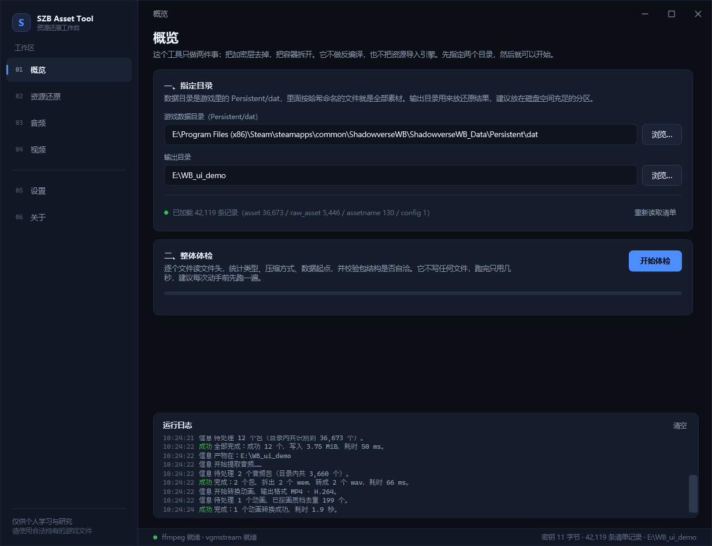
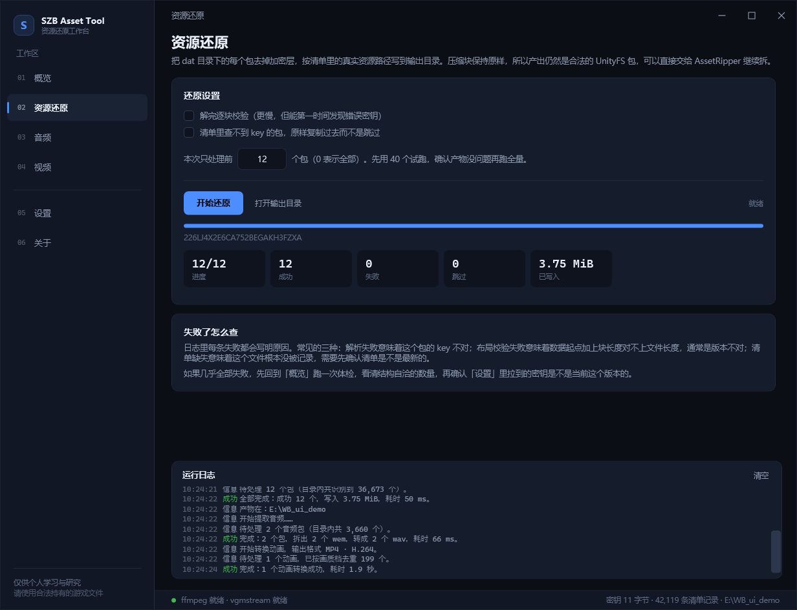
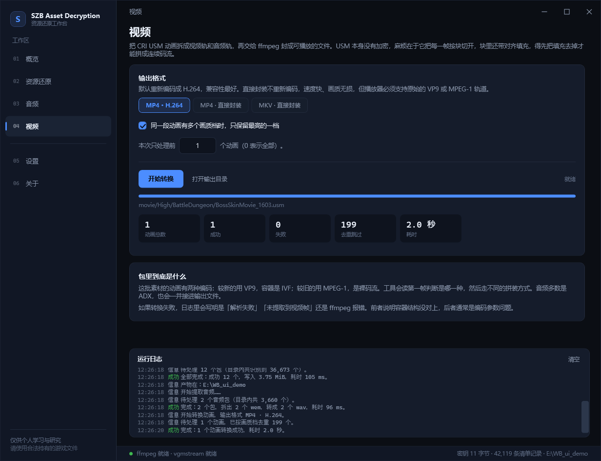

# SZB Asset Decryption

Reverse-engineering notes and a restoration tool for the **encrypted Unity AssetBundles** shipped
with *Shadowverse: Worlds Beyond* (SZB / SVWB).

> 中文版: [`README.zh-CN.md`](README.zh-CN.md)

The game modifies every AssetBundle with a streaming XOR cipher applied **after** the first 256 bytes.
Stock tools such as AssetRipper or AssetStudio therefore read the bundle header fine, but fail on
every data block:

```
AssetRipper.IO.Files.Exceptions.DecompressionFailedException:
  Could not write any bytes for 'cab-b730676aac4eb825c976cf950b770e95'
  while decompressing Lz4HC.
```

This repository documents the cipher, the recovery of the key **without reading it from memory or the
executable**, and provides a C# desktop tool that turns the on-disk files back into plain `UnityFS`
bundles.

| | |
|---|---|
| **Cipher** | `keystream[i] = base[(i % 88) >> 3] ^ key[(i % 88) & 7]`, applied from absolute offset `0x100` |
| **Base key** | 11 bytes (period 88), recovered by GF(2) linear algebra. **Neither compiled in nor downloaded** — derived from the local install each time |
| **Per-file key** | `int64`, published in the game's own `assetbundle.manifest` |
| **Coverage** | 36 673 / 36 673 UnityFS bundles restored, 0 failed block checks, 20.49 GiB |
| **Verification** | 400 random bundles parsed by UnityPy (an independent implementation), 22 111 objects read |

---

## Contents

| Path | What is inside |
|---|---|
| `docs/` | The full analysis, written as a security report. Start with [`docs/03_WALKTHROUGH.md`](docs/03_WALKTHROUGH.md) |
| `lessons/` | The original Python scripts used during the investigation. **Teaching material, not a product.** |
| `src/SZB_Asset_Decryption.Core/` | The real implementation: bundle parsing, decryption, manifest, audio and video containers |
| `src/SZB_Asset_Decryption.App/` | WPF desktop interface |
| `src/SZB_Asset_Decryption.Cli/` | Command-line front end (`derive`, `restore`, `audio`, `video`, `verify`, `selftest`) |
| `tools/fetch-deps.ps1` | Downloads the external CLI decoders (`ffmpeg`, `vgmstream-cli`) |
| `.github/workflows/` | CI: compile check on every push, and tag-triggered builds published to Releases |

---

## Quick start

### Just want to run it

Grab the latest `SZB_Asset_Decryption-*-win-x64.zip` from [Releases](../../releases), unpack it, run `SZB_Asset_Decryption.exe`.
It carries its own .NET runtime and the two decoders, so nothing else needs installing.

### Requirements

* Windows 10/11 and the .NET 10 SDK (the projects target `net10.0` / `net10.0-windows`)
* The game installed locally (only the `Persistent/dat` folder is needed)
* `ffmpeg.exe` and `vgmstream-cli.exe` — bundled in the release zip; for a source build, the app can fetch them for you, see [docs/08_TOOLING.md](docs/08_TOOLING.md). `ffprobe.exe` is not used.
* **No network access required.** The base key is computed from files already on disk.

### Build

```powershell
dotnet build src/SZB_Asset_Decryption.sln -c Release
```

### Run

```powershell
dotnet run --project src/SZB_Asset_Decryption.App -c Release
```

Then:

1. **Game folder** → point at `...\ShadowverseWB_Data\Persistent\dat`
2. **Manifest** → normally auto-detected. The game stores its own exact-version manifest inside `dat`,
   and the tool finds and parses it for you.
3. **Output** → pick an empty folder
4. **Key** → fetched automatically on start-up, see below
5. Press **Restore**. The tool writes a mirror tree of plain `.ab` files named after the real asset path,
   ready to be dropped into AssetRipper. Set AssetRipper's Default Version first — the bundles carry a
   stripped version string, see [docs/12_DOWNSTREAM.md](docs/12_DOWNSTREAM.md).

The `Audio` and `Video` tabs do the same for the two container formats that are *not* Unity bundles.

### Where the base key comes from

The key is data, not code, and is not hosted anywhere. It is computed from the local install each
time the tool needs it. Nothing is downloaded; no key ships in the binary or the repository.

The tool needs one input it cannot generate: the manifest the game stores inside `Persistent/dat`,
which supplies each bundle's `int64` key. The rest is arithmetic:

| Step | What happens |
|---|---|
| 1 | Read the local manifest → one `int64` key per bundle. |
| 2 | Scan bundle headers. Two archives with the same content but different data offsets form a pair where the plaintext cancels out. |
| 3 | XOR the two ciphertexts and the two keys: `base[a] ^ base[b]`. If the plaintext really is identical this value stays constant across eight consecutive bytes (2^-56 by chance otherwise). Each such window is a linear equation over GF(2). |
| 4 | Try key lengths 2..64 and run Gaussian elimination. A wrong length produces `0 = 1`. Only 11 — and its multiples — are consistent. |
| 5 | Rank is 80 of 88 unknowns, so 256 candidates survive. Feed each to LZ4: only the real one decompresses to the declared block size. |

About twenty seconds, ~34 000 readable bundles, and a few dozen same-content pairs. `SZB_Asset_Decryption.Cli derive
--dat <dir>` runs exactly this and prints the answer with the counts that produced it.

If the key is empty, `Restore` refuses to start rather than write twenty gigabytes of half-encrypted
bundles.

The result is cached at `%LOCALAPPDATA%\SZB_Asset_Decryption\base-key.json`, tied to the manifest's size and
timestamp — a game update invalidates it automatically, and **重新计算** in Settings forces a fresh run.

---

## Desktop interface

Six pages, one job each. Every CLI operation is available in the interface, and the run log is shared
across pages.



**Overview** picks the two folders, loads the manifest (42 119 rows, auto-detected from inside `dat`) and
runs a read-only census: how many files, how big, which kinds, how many bundles parse, how many straddle
the `0x100` boundary where the cipher starts.



**Restore** removes the XOR layer and writes a mirror tree named after the real asset paths. The run above
is a 12-bundle smoke test: 12/12 in 59 ms, 3.75 MiB.



**Video** demuxes USM and hands the elementary streams to ffmpeg. Quality tiers are collapsed first — one
movie usually ships as `High` / `Middle` / `Low`, so 200 files become 1.

* **Errors name the file and the reason.** Every error line carries both
  (`解析失败` = wrong key, `布局校验失败` = version mismatch, `清单缺失` = not in the manifest).
* **Runs can be capped.** The `本次只处理前 N 个` box limits a job to the first N items, so a wrong output
  folder costs N items rather than 20 GiB.

The screenshots above are generated by the app itself (`SZB_Asset_Decryption.exe --shot docs/img --run`), which renders
every page off-screen and, with `--run`, executes a small real job on each task page first. It is used as a
smoke test: if any page fails to build its visual tree, the command throws. The whole run happens offline —
including the key derivation shown in the Settings page.

### Command line

`SZB_Asset_Decryption.Cli` exposes the same engine:

```powershell
# restore every UnityFS bundle
SZB_Asset_Decryption.Cli restore --dat "D:\...\Persistent\dat" --out "D:\restored"

# unpack every Wwise .pck into .wem and convert to .wav
SZB_Asset_Decryption.Cli audio  --dat "D:\...\Persistent\dat" --out "D:\audio" --format wav

# demux every CRI .usm into .mp4
SZB_Asset_Decryption.Cli video  --dat "D:\...\Persistent\dat" --out "D:\video" --format mp4

# classify the whole directory and print a census
SZB_Asset_Decryption.Cli scan   --dat "D:\...\Persistent\dat"
```

---

## What the game actually changed

The container is unmodified. It is a standard **UnityFS v8** bundle:

```
"UnityFS\0" | version | unityVersion | unityRevision | size | ciBlock | uiBlock | flags
            | compressed blocksInfo | 16-byte align | data blocks
```

The only modification is a byte-wise XOR applied to everything from offset `0x100` to EOF:

```
offset 0x000 .. 0x0FF   plaintext   (header, block table — this is why tools see a valid bundle)
offset 0x100 .. EOF     ciphertext  (blocksInfo tail + every data block)
```

The keystream is periodic with period `8 × len(base)`, and within one period byte `i` is
`base[i >> 3] ^ key[i & 7]`. `key` is a signed 64-bit integer that differs per file.

The base was not taken from the executable or process memory. It was solved as a system of linear
equations over GF(2), using pairs of bundles that share the same compression stream but start at a
different `data_start`. The derivation, including two dead ends, is in
[`docs/03_WALKTHROUGH.md`](docs/03_WALKTHROUGH.md).

---

## Tooling decisions

| Task | Own code | External CLI | Why |
|---|---|---|---|
| UnityFS parsing + XOR | ✅ C# | — | No existing tool handles this cipher |
| Manifest (msgpack) parsing | ✅ C# | — | ~300 lines, fixed schema, no dependency needed |
| AKPK (Wwise `pck`) unpack | ✅ C# | — | Chunk chain plus a 12-byte-per-entry index. `wwiser` analyses banks; it does not export |
| CRI USM demux | ✅ C# | — | Simple block chain; codec work is delegated |
| WEM → WAV | — | ✅ `vgmstream-cli` | Wwise Vorbis uses a private codebook layout; reimplementation cost outweighs the benefit |
| MPEG-1 / VP9 / H.264 decode | — | ✅ `ffmpeg` | Video decoding is not implemented here |
| MP4 / MKV muxing | — | ✅ `ffmpeg` | Same |
| GUI | ✅ WPF | — | Product-specific |

Both external tools run as **separate processes** and are not linked into this application, keeping
the repository's MIT licence clean; see [`THIRD-PARTY-NOTICES.md`](THIRD-PARTY-NOTICES.md).

---

## Code census

The directory holds 40 702 files in four groups:

| Kind | Count | Size | Handling |
|---|---|---|---|
| UnityFS bundle | 36 673 | 20.5 GiB | XOR restore → `.ab` |
| AKPK (Wwise `pck`) | 3 660 | 2.92 GiB | unpack → `.wem` (named after the Wwise event) → `vgmstream` → `.wav` |
| CRID (CRI `usm`) | 346 | 2.80 GiB | demux → `ffmpeg` → `.mp4` |
| PNG / OTF / other | 23 | 54 MiB | already plain files |

Of the 346 videos, 326 are VP9-in-IVF and 20 are MPEG-1 elementary streams; 6 carry an ADX audio track.
Of the 3 660 sound banks, 14 986 individual waveforms were counted.

---

## Credits — what `wbunpacker` contributed

[`wbunpacker` (wbu)](https://github.com/Hypnos-PD/wbunpacker) is a Rust tool by **Hypnos-PD** that
downloads, decrypts and exports SZB assets. It supplied the structural facts that made this analysis
possible:

### 1. It described the structure of the cipher

`crates/asset/src/lib.rs` contains `AssetBundleDecryptor`. That struct provides three facts:

```rust
const HEADER_SKIP_BYTES: u64 = 0x100;

// keystream layout, reconstructed from the struct's constructor
keystream[i * 8 + j] = base_keys[i] ^ asset_key_bytes[j];
```

* the cipher starts at absolute offset `0x100`, not at `data_start` and not after the header;
* the keystream is periodic, with a period that is a multiple of the base key length;
* each period is `base[i >> 3] ^ key[i & 7]` — i.e. **byte `j` of the per-file key only ever affects
  keystream positions congruent to `j` mod 8**.

This fact makes the “8 plaintext bytes → 8 key bytes” attack in `docs/03_WALKTHROUGH.md` sound, and it
established that the base key is short enough to solve with linear algebra rather than brute force.
Without it, the only known fact would be that the data is encrypted.

### 2. It confirmed the per-file key is an `int64` that lives in the manifest

`asset_key: i64` in the constructor signature, together with the `asset_bundle_base_keys` config entry,
established that the key material is **per-asset and data-driven**, so the manifest must contain it. The
search reduces to “parse the manifest, join on filename”; `docs/05_MANIFEST.md` covers it.

### 3. It documented the surrounding pipeline

* manifest retrieval from the CDN and its MasterMemory + msgpack layout,
* the fact that AKPK payloads are Wwise banks that `vgmstream` can decode,
* the `vgmstream` → `ffmpeg` chain for audio,
* `AssetStudioModCLI` as the downstream extractor (this project uses AssetRipper; the approach is the
  same: restore to a plain bundle, then hand off),
* the existence of a SQLite3MC-encrypted `meta.db`.

### What this project adds

`wbunpacker` **consumes** a base key supplied by the user (`asset_bundle_base_keys`, base64). It does not
document where that value comes from, and the value is not published in the repository.

This project recovers the base key **from the game files alone**, without memory scraping, a debugger,
or the executable's constants:

```
base = <11 bytes>        (solved from the ciphertext; see docs/03_WALKTHROUGH.md)
```

The tool does not freeze one build's value into a binary or config file; it recomputes from the local
files every time, because the value changes when the game updates. `docs/02_ENCRYPTION.md` records the
value this analysis produced and the version it belongs to.

Thanks to `wbunpacker` for publishing the mechanism.

---

## Legal

This repository contains **no game assets and no game code**. It contains file-format documentation and
original source code. Use it only on a copy of a game you legitimately own, for personal study,
interoperability, or preservation. Do not redistribute extracted assets.

---

## Documentation index

| Document | Content |
|---|---|
| [`docs/00_GLOSSARY.md`](docs/00_GLOSSARY.md) | Every term used below, in plain language |
| [`docs/01_UNITYFS_FORMAT.md`](docs/01_UNITYFS_FORMAT.md) | The container format, field by field |
| [`docs/02_ENCRYPTION.md`](docs/02_ENCRYPTION.md) | The cipher, precisely specified |
| [`docs/03_WALKTHROUGH.md`](docs/03_WALKTHROUGH.md) | **The investigation, step by step, including dead ends** |
| [`docs/04_PITFALLS.md`](docs/04_PITFALLS.md) | 14 concrete problems |
| [`docs/05_MANIFEST.md`](docs/05_MANIFEST.md) | The manifest format and how keys are joined |
| [`docs/06_AUDIO.md`](docs/06_AUDIO.md) | AKPK / Wwise banks |
| [`docs/07_VIDEO.md`](docs/07_VIDEO.md) | CRI USM / Sofdec |
| [`docs/08_TOOLING.md`](docs/08_TOOLING.md) | Why each dependency is either written or borrowed |
| [`docs/09_VERIFICATION.md`](docs/09_VERIFICATION.md) | How correctness was verified |
| [`docs/10_UI.md`](docs/10_UI.md) | The desktop interface, and seven implementation problems |
| [`docs/11_BASE_KEY_SOLVER.md`](docs/11_BASE_KEY_SOLVER.md) | The solver as implemented, and four porting problems |
| [`docs/12_DOWNSTREAM.md`](docs/12_DOWNSTREAM.md) | Handing the output to AssetRipper: empty exports, batch size, output layout |
