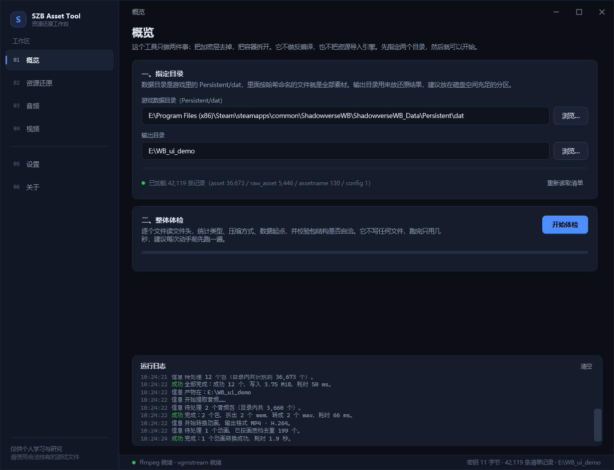
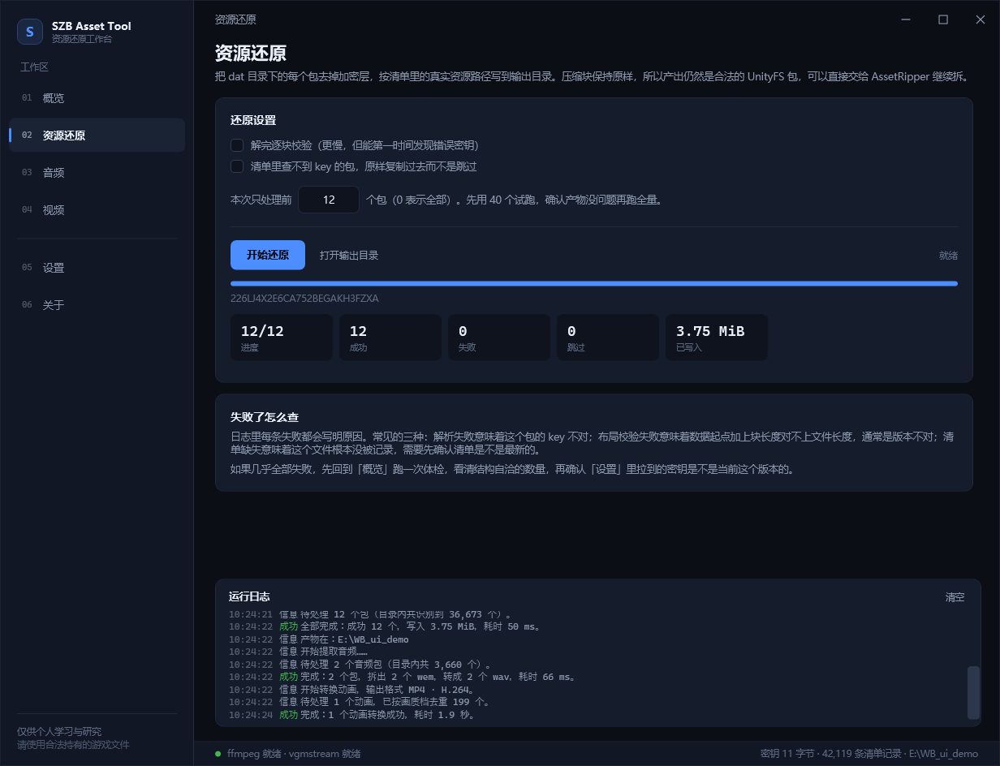
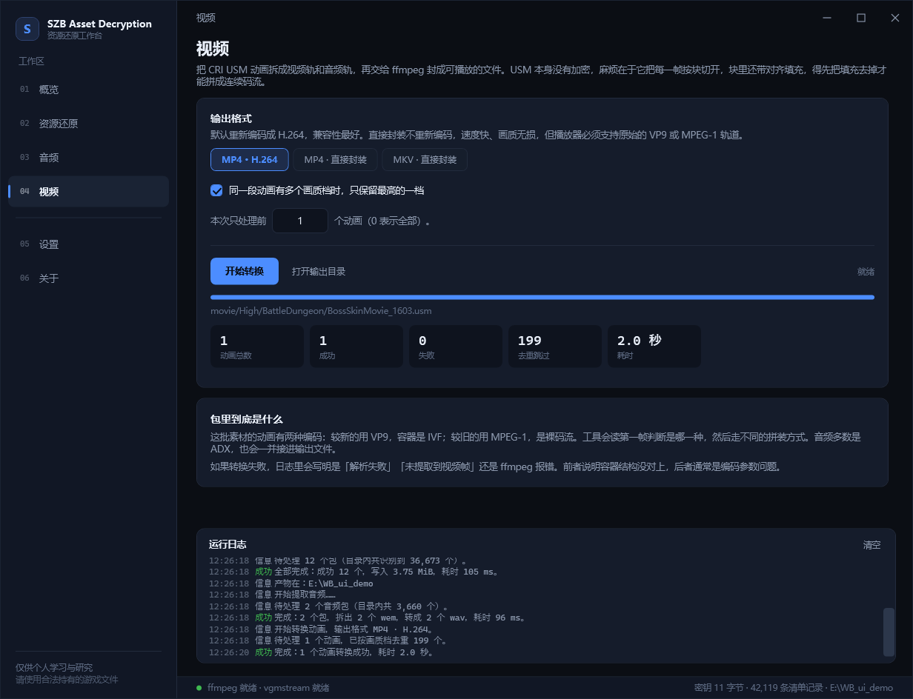

# SZB Asset Decryption

《Shadowverse: Worlds Beyond》（SZB / SVWB）加密 AssetBundle 的逆向分析记录，以及一套 C# 还原工具。

> English version: [`README.md`](README.md)

游戏给每个 AssetBundle 加了一层流式 XOR，作用范围是**文件偏移 `0x100` 之后的全部内容**。
所以 AssetRipper 这类现成工具能正常读出包头、也能正常显示"这是个 UnityFS 包"，但只要开始解
数据块就全崩：

```
AssetRipper.IO.Files.Exceptions.DecompressionFailedException:
  Could not write any bytes for 'cab-b730676aac4eb825c976cf950b770e95'
  while decompressing Lz4HC.
```

本仓库做三件事：

1. **讲清楚这层加密到底长什么样**（`docs/02_ENCRYPTION.md`）
2. **讲清楚 base 密钥是怎么在不读内存、不调试、不看 exe 的前提下算出来的**（`docs/03_WALKTHROUGH.md`）
3. **给一个带界面的 C# 工具**，把这些文件变回 AssetRipper 能直接吃的普通 `.ab`（`src/`）

---

## 概要

| 项目 | 值 |
|---|---|
| 加密算法 | `keystream[i] = base[(i%88)>>3] ^ key[(i%88)&7]`，从绝对偏移 `0x100` 开始 |
| base 密钥 | 11 字节（周期 88），由 GF(2) 线性方程组解出；**不编进程序，也不从网上拉**，每次从本地文件算 |
| 每文件密钥 | 一个 `int64`，就写在游戏自己的 `assetbundle.manifest` 里 |
| 覆盖率 | 36 673 / 36 673 个 UnityFS 包全部还原，逐块校验 **0 失败**，共 20.49 GiB |
| 验收 | 随机抽 400 个产物用 UnityPy（独立实现）解析，读出 22 111 个对象 |

---

## 容器本身没有改动

去掉加密层后是标准 **UnityFS v8** 包，字段未作修改：

```
"UnityFS\0" | 版本号 | unityVersion | unityRevision | 文件总长 | blocksInfo压缩长度 | 解压长度 | flags
            | 压缩后的 blocksInfo | 补齐到 16 字节 | 数据块们
```

唯一的变化，是从 `0x100` 开始整体 XOR：

```
偏移 0x000 ~ 0x0FF    明文   ← 包头与块表在此，现成工具因此认为包是完整的
偏移 0x100 ~ 文件末尾  密文   ← blocksInfo 的尾巴 + 所有数据块
```

密钥流以 `8 × len(base)` 为周期循环。在一个周期内，第 `i` 个字节等于 `base[i>>3] ^ key[i&7]`。
`key` 是每个文件不一样的 64 位有符号整数。

**base 不是从 exe 或内存中取得的**，而是解 GF(2) 线性方程组得到。
思路是找"压缩流相同、但 `data_start` 不同"的包对，用它们的密文差值构造方程，高斯消元。
完整推导（包括先撞上的两条死路）在 [`docs/03_WALKTHROUGH.md`](docs/03_WALKTHROUGH.md)。

---

## 工具分工：什么自己写，什么直接调现成的

见 [`docs/08_TOOLING.md`](docs/08_TOOLING.md)。

| 功能 | 自己写 | 调现成 | 理由 |
|---|---|---|---|
| UnityFS 解析 + XOR | ✅ C# | — | 现有工具不支持这层加密 |
| manifest（msgpack）解析 | ✅ C# | — | 约 300 行，结构固定，无需引入依赖 |
| AKPK（Wwise `.pck`）拆包 | ✅ C# | — | chunk 链 + 12 字节一条的索引表，实现成本低 |
| CRI USM 拆流 | ✅ C# | — | 块链结构简单，编解码交给外部工具 |
| WEM → WAV | — | ✅ `vgmstream-cli` | Wwise Vorbis 使用私有码本布局，自行实现成本高 |
| MPEG-1 / VP9 / H.264 解码 | — | ✅ `ffmpeg` | 视频解码不自行实现 |
| MP4 / MKV 封装 | — | ✅ `ffmpeg` | 同上 |
| 界面 | ✅ WPF | — | 产品需求 |

两个外部工具都是**独立进程**调用，不链接进本程序。本仓库保持 MIT，它们的许可单独说明在
[`THIRD-PARTY-NOTICES.md`](THIRD-PARTY-NOTICES.md)。

---

## 目录里到底有什么

40 702 个文件，按内容分为四类：

| 类型 | 数量 | 体积 | 怎么处理 |
|---|---|---|---|
| UnityFS 包 | 36 673 | 20.5 GiB | XOR 还原 → `.ab` |
| AKPK（Wwise `.pck`） | 3 660 | 2.92 GiB | 拆包 → `.wem` → `vgmstream` → `.wav` |
| CRID（CRI `.usm`） | 346 | 2.80 GiB | 拆流 → `ffmpeg` → `.mp4` |
| PNG / OTF / 其它 | 23 | 54 MiB | 本来就是明文 |

346 个视频里，326 个是 VP9（IVF 封装），20 个是 MPEG-1 裸流，6 个带 ADX 音轨。
3 660 个音频包里共数出 14 986 条波形。

---

## 快速开始

### 环境

* Windows 10/11
* .NET 10 SDK（项目目标是 `net10.0` / `net10.0-windows`）
* 装了游戏（只用 `ShadowverseWB_Data\Persistent\dat` 这个目录）
* `ffmpeg.exe` 和 `vgmstream-cli.exe`（程序里有一键下载，或者看 [`docs/08_TOOLING.md`](docs/08_TOOLING.md)）
* **全程不需要联网。** base 密钥是从已经躺在硬盘上的文件里算出来的。

### 编译

```powershell
dotnet build src/SZB_Asset_Decryption.sln -c Release
```

### 运行

```powershell
dotnet run --project src/SZB_Asset_Decryption.App -c Release
```

界面里四步：

1. **游戏目录** → 选到 `...\ShadowverseWB_Data\Persistent\dat`
2. **Manifest** → 一般不用管，工具会自己在 `dat` 里找到游戏自带的精确版本 manifest
3. **输出目录** → 选个空文件夹
4. 点 **开始还原**（密钥会自动算，见下一节）

出来的是一棵按真实资源路径命名的 `.ab` 目录树，直接拖进 AssetRipper 就行。第一次用先设好
AssetRipper 的 Default Version，包头的版本号是被抹过的，见 [`docs/12_DOWNSTREAM.md`](docs/12_DOWNSTREAM.md)。
`音频` / `视频` 两个页签做同样的事，处理那两类非 Unity 容器。

### 基础密钥从哪来

密钥是数据，不写在代码里，也不托管在任何位置。每次需要时从本地游戏文件现算，不下载，仓库和 exe 中都没有这个值。

程序唯一离不开的外部输入，是游戏本来就存在 `Persistent/dat` 里的那份清单，它提供每个包自己的
`int64` key。剩下的全是算术：

| 步骤 | 发生什么 |
|---|---|
| 1 | 读本地清单 → 每个包一个 `int64` key |
| 2 | 扫包的文件头。找"内容相同、但数据起点不同"的两个包——它们互为对照，明文可以约掉 |
| 3 | 两个密文和两个 key 一起异或，得到 `base[a] ^ base[b]`。如果明文真的一样，这个值在连续 8 个字节内必须恒定（纯属巧合的概率是 2^-56）。每个这样的窗口就是一条 GF(2) 线性方程 |
| 4 | 长度从 2 试到 64，做高斯消元。长度猜错会解出 `0 = 1`。只有 11（以及它的倍数）自洽 |
| 5 | 秩 80 / 88 个未知数，所以还剩 256 个候选。逐个丢给 LZ4：只有真解能解出块表声明的那一长度 |

大约 20 秒，需要三万多份可读的包和几十对同内容包。`SZB_Asset_Decryption.Cli derive --dat <目录>` 跑的就是这一套，
会把结果和"用了多少包、多少对"一起打印出来。

密钥为空时 `开始还原` 拒绝运行，不会写出二十 GB 的半加密包。

算出来的结果缓存在 `%LOCALAPPDATA%\SZB_Asset_Decryption\base-key.json`，跟着清单的大小和修改时间走——
游戏一更新自动失效，设置页的 **重新计算** 可以强制重跑。

---

## 界面长什么样

六个页面各负责一类任务。命令行的功能都能在界面完成，运行日志共用。



**概览** 选两个目录，读清单（自动从 `dat` 里找到 42 119 行），然后跑一次只读体检：多少个文件、多大、
都是什么类型、多少个包能解析、多少个的块表跨过了加密起点 `0x100`。



**资源还原** 去掉 XOR 层，按真实资源路径写出镜像目录树。上面这次是 12 个包的试跑：12/12 成功，
59 毫秒，写入 3.75 MiB。



**视频** 拆开 USM 后交给 ffmpeg。之前会先按画质档去重——一段动画往往同时有 `High` / `Middle` / `Low`
三份，200 个文件对应几十段。

* **错误写明文件与原因。** 每条错误给出文件和理由（`解析失败` = key 不对，
  `布局校验失败` = 版本不对，`清单缺失` = 清单中没有该文件）。
* **任务可限流。** `本次只处理前 N 个` 把任务限制在前 N 个，避免写满 20 GiB 后才发现输出目录选错。

上面的截图是程序自己生成的（`SZB_Asset_Decryption.exe --shot docs/img --run`）：离屏把每一页渲染成 PNG，
带 `--run` 时会先在三个任务页上各跑一个小任务。它同时是冒烟测试：任一页面的视觉树构建失败，命令直接抛错。整轮出图不联网，包括设置页里显示的那次密钥推导。

### 命令行

```powershell
SZB_Asset_Decryption.Cli restore --dat "D:\...\Persistent\dat" --out "D:\restored"
SZB_Asset_Decryption.Cli audio   --dat "D:\...\Persistent\dat" --out "D:\audio" --format wav
SZB_Asset_Decryption.Cli video   --dat "D:\...\Persistent\dat" --out "D:\video" --format mp4
SZB_Asset_Decryption.Cli scan    --dat "D:\...\Persistent\dat"
```

---

## 致谢：`wbunpacker` 的作用

[`wbunpacker`（wbu）](https://github.com/Hypnos-PD/wbunpacker) 是 Hypnos-PD 写的 Rust 工具，负责下载、解密、导出 SZB 资源。本项目从中取得了加密结构的关键信息。

### 1. 它描述了加密的结构

`crates/asset/src/lib.rs` 里的 `AssetBundleDecryptor` 给出三条信息：

```rust
const HEADER_SKIP_BYTES: u64 = 0x100;

// 从构造函数反推出来的密钥流布局
keystream[i * 8 + j] = base_keys[i] ^ asset_key_bytes[j];
```

* 加密从**绝对偏移 `0x100`** 开始，不是 `data_start`，也不是包头之后。
* 密钥流是周期性的，周期是 base 长度的整数倍。
* 每个周期内是 `base[i>>3] ^ key[i&7]`。即**每文件密钥的第 `j` 个字节只影响密钥流中位置模 8 等于 `j` 的字节。**

这一条使"8 个明文字节 → 8 个密钥字节"的攻击成立，也确定 base 长度足够短，可用线性代数求解而非暴力搜索。缺少这个结构信息时，只能判断数据被加密，无法确定求解方向。

### 2. 它确认了每文件密钥是一个 `int64`，且由数据驱动

构造函数签名里的 `asset_key: i64` 和配置项 `asset_bundle_base_keys` 说明密钥按资源提供、由数据驱动，因此必然存在于某个清单文件中。求解路径由此变为"解析 manifest，按文件名 join"，见 [`docs/05_MANIFEST.md`](docs/05_MANIFEST.md)。

### 3. 它记录了周边管线

* manifest 从 CDN 拿，格式是 MasterMemory + msgpack；
* AKPK 里装的是 Wwise bank，`vgmstream` 能解；
* 音频链路 `vgmstream` → `ffmpeg`；
* 下游用 `AssetStudioModCLI`（本项目改用 AssetRipper，思路相同：先还原成普通包再交给现成工具）；
* 还有个 SQLite3MC 加密的 `meta.db`。

### 本项目的补充

`wbunpacker` 使用用户提供的 base 密钥：配置里的 `asset_bundle_base_keys` 需自行填写 base64。它没有说明该值的来源，仓库中也没有公开。

本项目只凭游戏文件算出 base，不读内存、不挂调试器、不从 exe 取常量：

```
base = <11 字节>        （从密文解出来的，推导见 docs/03_WALKTHROUGH.md）
```

工具不把某一版的值写入二进制或配置文件，而是每次从本地文件重算，因为游戏更新后该值会变。`docs/02_ENCRYPTION.md` 记录了本次分析得到的值及其对应版本。

感谢 `wbunpacker` 公开了足以确定求解方向的机制。

---

## 法律声明

本仓库**不包含任何游戏资源、不包含任何游戏代码**，只有格式文档和自己写的源码。
请仅对你合法拥有的游戏副本使用，用于个人学习、互操作性研究或资料保存。不要把导出的资源再分发。

---

## 文档索引

| 文档 | 内容 |
|---|---|
| [`docs/00_GLOSSARY.md`](docs/00_GLOSSARY.md) | 全部术语的通俗解释 |
| [`docs/01_UNITYFS_FORMAT.md`](docs/01_UNITYFS_FORMAT.md) | 容器格式，逐字段说明 |
| [`docs/02_ENCRYPTION.md`](docs/02_ENCRYPTION.md) | 加密算法的严格定义 |
| [`docs/03_WALKTHROUGH.md`](docs/03_WALKTHROUGH.md) | **完整分析过程，含失败路径** |
| [`docs/04_PITFALLS.md`](docs/04_PITFALLS.md) | 14 个实际问题 |
| [`docs/05_MANIFEST.md`](docs/05_MANIFEST.md) | manifest 格式与密钥关联 |
| [`docs/06_AUDIO.md`](docs/06_AUDIO.md) | AKPK / Wwise |
| [`docs/07_VIDEO.md`](docs/07_VIDEO.md) | CRI USM / Sofdec |
| [`docs/08_TOOLING.md`](docs/08_TOOLING.md) | 各依赖自研或外借的理由 |
| [`docs/09_VERIFICATION.md`](docs/09_VERIFICATION.md) | 结果的验证方法与证据 |
| [`docs/10_UI.md`](docs/10_UI.md) | 界面结构，以及七个实现问题 |
| [`docs/11_BASE_KEY_SOLVER.md`](docs/11_BASE_KEY_SOLVER.md) | 求解器的实现，以及四个移植问题 |
| [`docs/12_DOWNSTREAM.md`](docs/12_DOWNSTREAM.md) | 交给 AssetRipper：导出为空、分批导入、输出目录结构 |
